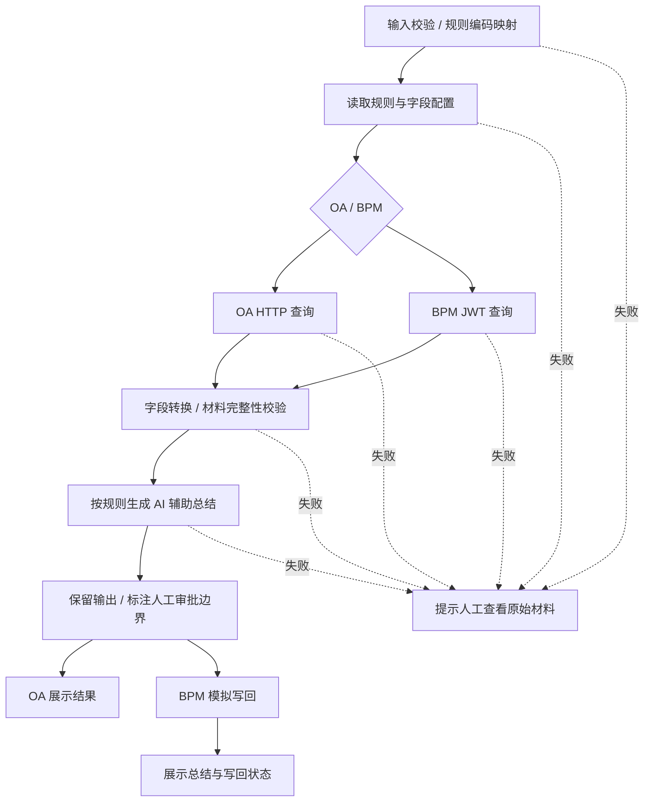

# 企业审批辅助助手

基于 Dify 的 OA / BPM 双系统工作流演示。将表单、规则与附件信息整理成可核对的材料，生成 AI 辅助总结，并把结果写回模拟 BPM 服务。最终审批由人完成。

**验证状态**：本地代码与 Mock 回归测试通过；尚未在实际 Dify 环境中验证导入、模型输出及完整运行。附件内容为固定模拟解析结果，无真实 OCR。详见[验证记录](docs/validation.md)。

## 业务场景

审批人需要在多个系统查看表单与附件，重复确认字段、金额和缺失材料。本项目用虚构的请假与采购场景演示一种辅助方式：先验证数据和材料完整性，再由模型整理信息，保留人工核实与最终决策。

- **OA 请假**：申请人、部门、起止时间、天数、事由及模拟请假单。
- **BPM 采购**：采购事由、明细、总额及模拟报价表；代码先核对金额，再调用模型。
- **异常处理**：规则、必需字段、必需附件不可用时停止生成总结；可选附件失败需在模型输入中明确披露。

## 工作流



示意图合并了两条路径中相同职责的节点；DSL 保留独立的 OA/BPM 数据处理和模型节点。

## 先在本机演示

需要 Python 3.9+。在本项目目录执行：

```bash
python3 -m venv .venv
source .venv/bin/activate
python -m pip install -r requirements-dev.txt
python demo.py
python -m unittest discover -s tests -v
```

Windows 激活命令为 `.venv\Scripts\activate`。

`demo.py` 自动启动仅监听本机的临时服务，展示两个场景的数据整理、采购金额核对、模拟写回和不存在流程的错误处理，最后自动关闭服务。它不会调用 LLM，写回内容明确标为测试文本，不能当作模型效果演示。

Mock 服务本身只用 Python 标准库；测试和演示脚本需要 `requirements-dev.txt` 中的两个依赖。

## 在 Dify 中运行

1. 导入 [`workflow.yml`](workflow.yml)。这是 Chatflow，DSL 格式版本为 `0.5.0`；当前未声明已验证的 Dify 版本。
2. 配置模型供应商。DSL 保留 OpenAI-compatible 插件与 `qwen-plus` 名称；在**两个 LLM 节点**中选择你实际可用的模型。模型 API 密钥只配置在 Dify 中，不写入仓库。
3. 启动模拟服务。宿主机直接运行 Dify 时可用 `python mock_server.py`；Dify 在 Docker 中时可用 `python mock_server.py --host 0.0.0.0`，使容器能访问宿主机的 5050 端口。服务只处理虚构数据，勿用作公网服务。
4. 在 Dify 环境变量中设置 `mock_base_url`，默认是 `http://host.docker.internal:5050/mock`。本机直接运行可改为 `http://127.0.0.1:5050/mock`。全部 HTTP/代码节点统一读取该变量。
5. 检查 HTTP 节点与代码沙箱都能访问 Mock；两者可能经过不同代理。Linux Docker 的宿主机域名、代理和沙箱网络设置取决于部署，不能只给一个容器添加 hosts 就视为已连通。代码节点需要可用的 `requests`、出网权限及足够执行时限。当前仅针对本地演示编写说明，未验证 Dify Cloud。
6. 打开调试面板填写下表输入，并发送一句“请整理本次流程的核对要点”。当前工作流以表单输入为准，不使用聊天消息中的自由指令。

| 场景 | workflow_id | system_code | workflow_code | task_id | 预期 |
| --- | --- | --- | --- | --- | --- |
| 请假 | `10086` | `OA` | `LEAVE` | 留空 | 输出关键信息、核对结果、待人工确认 |
| 采购 | `20099` | `BPM` | `PURCHASE` | `demo-task` | 总结后显示模拟写回成功/失败 |
| 不存在的流程 | `99999` | `BPM` | `PURCHASE` | 留空 | 进入人工处理提示，不调用模型 |

Mock 在 `GET /mock/bpm/summary/20099` 提供最近一次模拟写回结果，例如：

```bash
curl http://127.0.0.1:5050/mock/bpm/summary/20099
```

结果仅保存在 Mock 进程内存中，重启清空；同一流程再次写回会覆盖。`task_id` 仅记录，不会唤醒任何真实流程节点。

## 实现与边界

| 能力 | 实现方式与限制 |
| --- | --- |
| 规则获取 | 每次运行通过 API 获取规则；Mock 的规则在进程启动时加载，修改文件需重启，不是配置后台或热更新系统 |
| 字段管理 | 同行中英文配对、必需字段校验、扁平/嵌套路径、显式日期类型；时间统一为 UTC+8 |
| 金额核对 | `Decimal` 校验明细乘积和总额；当前示例不涉及税额、币种换算与会计舍入规则 |
| 附件处理 | 规则传到模拟解析接口并提供给模型；必需附件失败则停止，可选附件失败明确标记；没有真实文件读取或 OCR |
| 模型边界 | 业务数据放在 user 消息，可信规则放在 system；这是防护措施，不能据此宣称已抵抗提示注入 |
| JWT | 客户端 HS256 签名，Mock 校验签名、发行方和有效时间；全部密钥为公开的演示占位值，不构成生产认证方案 |
| 错误路径 | 取数、规则、数据处理、模型及输出节点配置失败分支；BPM 写回失败单独显示状态，保留总结 |

## 文件

| 文件 | 用途 |
| --- | --- |
| [`workflow.yml`](workflow.yml) | Dify DSL 与全部代码节点源码，代码以多行文本保存便于审阅 |
| [`mock_server.py`](mock_server.py) | 两个虚构流程、规则、附件解析夹具和模拟写回 API |
| [`demo.py`](demo.py) | 不需要 Dify 或模型密钥的本地链路演示 |
| [`tests/test_workflow.py`](tests/test_workflow.py) | 从 DSL 提取实际代码执行的回归测试 |
| [业务案例](docs/case-study.md) | 业务问题、方案、演示路径与能力边界 |
| [设计说明](docs/design.md) | 关键取舍与异常行为 |
| [验证记录](docs/validation.md) | 已验证内容与 Dify/模型验收项 |

本项目仅包含虚构资料及演示实现。没有接入实际审批系统，也不包含真实客户、员工资料或模型凭据。
