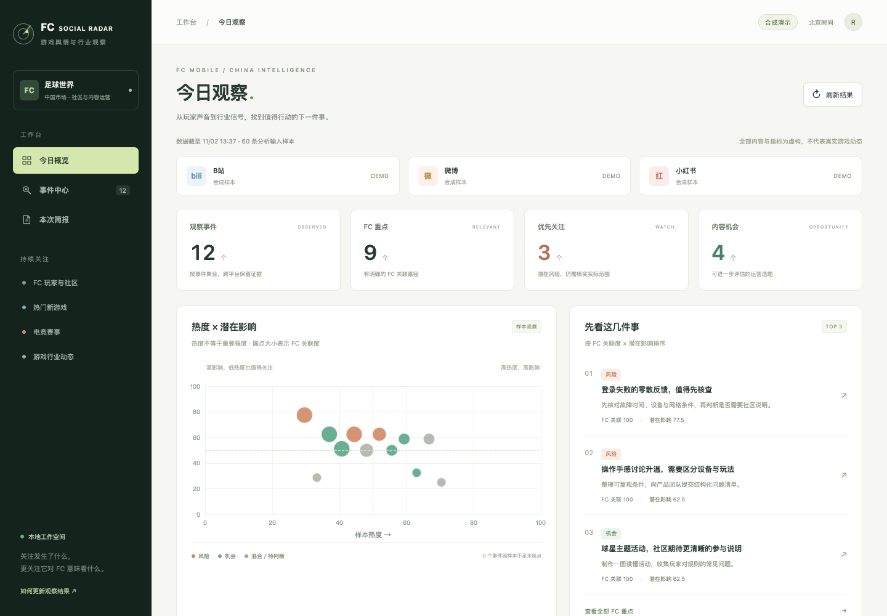

# FC Social Radar

面向 FC Mobile／足球世界中文市场的本地舆情工作台。监测 B站、微博、小红书，关注 FC 玩家反馈、竞品、足球热点、热门新游、电竞赛事与行业变化。

**真实采集与合成演示独立运行。三平台已各完成至少两次有样本的真实采集，仍有字段和检索覆盖缺口；已按用户要求以可运行原型加入 portfolio，人工质量验收待完成。** 实际验证记录见 [VALIDATION.md](VALIDATION.md)。本项目不是 EA 官方产品。

[查看项目案例](docs/portfolio-case-study.md) · [打开真实采集快照](https://zgjsczsyc.github.io/fc-social-radar-snapshot/)



上图展示合成演示。作品集根目录运行 `python3 serve.py` 会在 `http://127.0.0.1:8772` 启动仅使用内存合成数据的版本，与下面的真实模式和独立演示模式分开。

## 启动看板

需要 Node.js 24+ 和本机 Google Chrome；不需要单独模型 API 密钥。SQLite 使用 Node 内置模块，在 Node 24 中会提示实验性警告。

```bash
cd /Users/royshen/Documents/roy-ai-portfolio/projects/fc-social-listening
npm ci
npm run build
npm run demo
```

合成演示地址：<http://127.0.0.1:8771>。另开终端运行 `npm start`，真实数据地址：<http://127.0.0.1:8770>。Ctrl+C 停止对应服务。

合成演示包含 60 条虚构帖子、12 个事件，其中热门新游、电竞赛事各 15 条帖子。数字用于检查计算和交互，不属于真实业务结果。真实模式没有数据时显示空状态，不自动回退到演示数据。

## 让 Codex 完成一次真实监测

首次使用，依次执行以下命令。在专用 Chrome 窗口手动登录，完成后关闭该窗口，命令才会结束。不要在采集时同时打开同平台登录窗口。

```bash
npm run radar -- login --platform bilibili
npm run radar -- login --platform weibo
npm run radar -- login --platform xiaohongshu
```

之后在 Codex 中提出“运行 FC Social Radar，按项目 AGENTS.md 采集并生成本次简报”。也可以手动执行：

```bash
# 首次默认近 7 天；后续默认近 24 小时。可用 --days 7 或 --days 30。
npm run radar -- collect
# 接入诊断只查询足球世界，不读取详情；不是完整主题覆盖。
npm run radar -- collect --probe
# 单独更新一个平台
npm run radar -- collect --platform bilibili --days 7
# 输出 Codex 所需的帖子、运行记录、评分约束和 JSON 格式
npm run radar -- prepare-analysis
# Codex 读取上一步 input.json，分析后写入同一运行目录下的 analysis.json
npm run radar -- import-analysis --file /绝对路径/analysis.json
```

`prepare-analysis --run RUN_ID` 可明确选择采集记录。最新记录尚在运行时，默认选择最近已结束记录。分析导入失败不会破坏上次简报。看板中的“刷新结果”只重新读取数据，不会启动采集或模型。

### 新游与电竞的补充发现

Codex 从采集结果识别新实体，将候选名单写入仓库外的 `discovery.json`：

```json
{
  "candidates": [
    {"name": "材料中真实出现的游戏名称", "kind": "game", "evidenceIds": ["bilibili:真实ID"]},
    {"name": "材料中真实出现的赛事名称", "kind": "tournament", "evidenceIds": ["weibo:真实ID"]}
  ]
}
```

运行 `npm run radar -- collect --discovery /绝对路径/discovery.json --days 7`。候选按各平台内可见互动指标的分位排序（优先点赞，其次评论、浏览、转发），最多 5 个，检索实体名称与“官方”，不直接把不同平台互动量相加。没有互动数据时不臆造热度，按名称作稳定选择。检索结果仍需确认是否官方；找不到时标待核实。补充采集后重新 prepare、分析和 import。

### 人工材料

支持 `npm run radar -- import-posts --file /绝对路径/posts.json`。输入为 `{"posts":[...]}`，每条包含 `platform`、`nativeId`、`url`、`text`，可选 `title`、`publishedAt`、`authorId`、`authorName`、`metrics`、`comments`、`topics`、`sourceType`。时间使用 ISO 8601，缺失指标填 `null`。`sourceType` 默认 `unknown`，只有人工核验后才能填 `official` 或 `firsthand`。

人工材料标为 `manual`，不计作浏览器接入成功。必须保留合法的平台原文 URL。不要导入公司内部资料、凭据或私人聊天记录。

## 数据与接口

默认数据目录为 `~/.local/share/fc-social-radar/real/` 和 `~/.local/share/fc-social-radar/demo/`，包括 SQLite、登录会话和分析文件。文件夹权限为仅本人访问。可用 `FC_RADAR_DATA_DIR` 指向另一个仓库外目录；程序拒绝放进作品集仓库。

看板为只读接口：

| 接口 | 用途 |
| --- | --- |
| `GET /api/state` | 本模式的事件、证据、平台状态、版本与待分析提示 |
| `GET /api/export.md` | 下载本次 Markdown 简报 |
| `GET /api/export.html` | 下载独立 HTML 简报，可打印 |

服务器模式启动时固定，URL 参数不能切换数据库。仅监听 `127.0.0.1`。浏览器不直接访问社交平台、不携带登录信息、不调用模型 API。

## 评分与边界

- 热度在每个平台内部计算，再对可评分平台取等权均值；原始互动量不跨平台相加。它只描述可见检索样本。
- 基准优先过去 30 天至少 10 个不同事件，否则使用当前事件集合。当前也不足 10 个时不评分。
- 互动 40%、独立帖子 30%、作者 20%、增长 10%。互动中各可见指标分别计算分位数后取均值。缺失项按剩余权重计算；增长要求同帖至少间隔 24 小时、最多间隔 7 天的可比快照。
- FC 关联度只能为 0/25/50/75/100；100 分仅用于 FC Mobile／足球世界本身。关联度和影响度是模型辅助判断，不是统计事实。
- 潜在影响由强度 35%、范围 30%、紧迫性 20%、持续性 15%计算，各维度 0—4。FC 重点按关联度乘潜在影响排序；行业按样本热度排序。
- 证据等级独立于热度。转载不充当独立核实，模型不能自行将未知来源升级为官方。
- 已上线新游需有上线日期，且距采集时间不超过 90 天；电竞赛果不能使用未来比赛时间。不同比赛或事件类型必须分别建事件。
- 首版只读可见文字、简介、评论。没有转写视频、全量历史回补、全网舆情量估计或自动外发。

## 测试与人工验收

```bash
npm test
npm run build
npm run test:browser
npm run radar -- review-template
# 由人独立标注仓库外的 human-review.json，再执行：
npm run radar -- evaluate-review --file /绝对路径/human-review.json
```

人工验收需要至少 60 条真实样本，覆盖三平台，新游与电竞各至少 10 条；产品识别 ≥90%，主要分类 ≥80%，误合并率 ≤10%。误合并率采用被预测为同一事件的已复核样本对中，人工事件不同的比例。测试程序中的合成参考答案不等于人工评估。

已按用户明确要求以可运行原型加入作品集，设计与实测记录见 [portfolio-case-study.md](docs/portfolio-case-study.md)。作品集注册不替代人工质量验收，不宣称 EA 已使用或取得业务收益。

## 给同事分享真实快照

已发布：[FC Social Radar 真实采集快照](https://zgjsczsyc.github.io/fc-social-radar-snapshot/)。这是公开可访问的只读站点，保留待核实与覆盖缺口；原作品集仓库保持私有。

用户明确授权后，运行 `npm run share`。输出位于仓库外的真实数据目录 `real/share/<生成时间>/`，路径记录在 `real/share/latest.txt`。只上传该生成目录中的静态站点文件，不上传整个真实数据目录或私有源码仓库。

分享版保留事件、已引用摘录、平台原文链接、评分、待核实标记、覆盖失败和排除数量；不包含作者信息、评论、未引用帖子、数据库、浏览器登录会话或本机技术诊断。页面与 Markdown/HTML 简报标注数据截至时间、快照生成时间及非 EA 官方产品。时间筛选固定在采集窗口，不会随日历推移自动隐藏快照内容。

`node tests/share-browser.mjs` 在子路径下验证静态站点，使用真实快照，不启动采集。发布后设置 `FC_RADAR_SHARE_URL` 为完整的 HTTPS 网站地址（以 `/` 结尾），运行相同脚本检查线上页面。快照无登录或编辑功能，上传至公开静态托管时，任何获得网址的人都可以访问；`robots.txt` 仅请求搜索引擎不收录，并非访问控制。更新需重新导出和手动发布。
