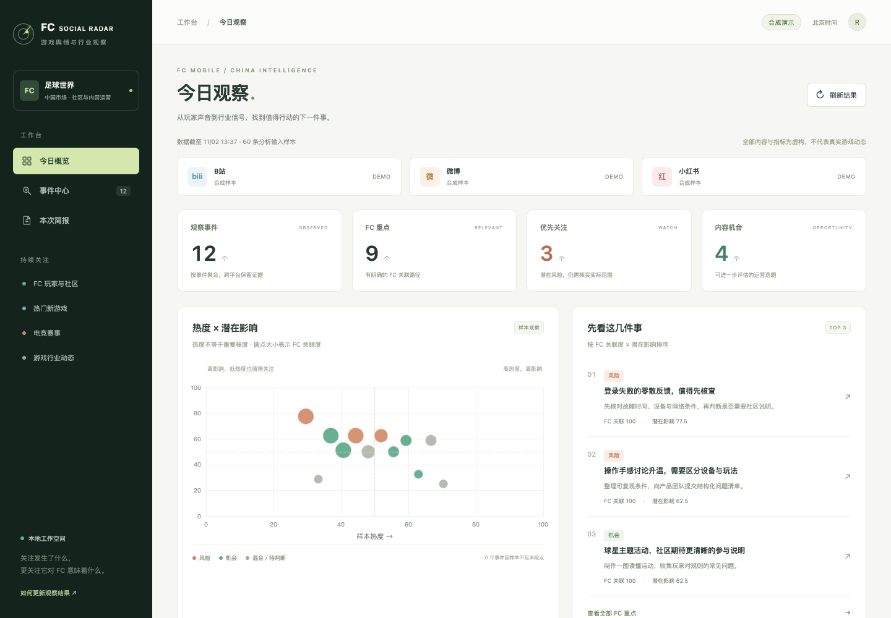

# FC Social Radar · 从社交讨论到游戏运营判断

面向 FC Mobile／足球世界中文社区的 Social Listening 原型，将玩家反馈、竞品、足球热点、热门新游、电竞赛事和行业变化整理为可追溯的事件与中文简报。

**项目状态**：2026-11-02 完成首轮真实采集与分享版发布，按用户要求加入作品集。可运行原型，独立人工质量验收待完成。个人项目，非 EA 官方产品，无内部部署或业务收益声明。

[打开真实采集快照](https://zgjsczsyc.github.io/fc-social-radar-snapshot/) · [运行说明](../README.md) · [验证记录](../VALIDATION.md)

上图全部为合成演示数据；在线入口展示独立发布的真实采集快照，并保留待核实和覆盖缺口。

## 业务问题

社区运营需要同时理解产品反馈和行业动态。跨平台的点赞、播放与转发不能直接相加；新游或电竞赛事讨论很热，也未必意味着 FC 玩家流失。少量直接涉及登录或玩法的问题，则可能需要优先核查。

项目要回答的是：发生了什么、证据是什么、与 FC 有何关系、可能影响什么、建议做什么，以及还需要验证什么。范围限定为免费来源、手动登录与手动运行，先建立可核查的观察流程。

## 工作内容与设计取舍

使用 Codex 协助完成需求拆解、监测主题与评分规则设计、采集适配、看板实现和验证。采集由 Playwright 读取三个平台正常可见的内容，分析由现有 Codex 会话执行，代码负责去重、评分、证据引用校验与版本保存。

- **将热度、关联度与影响分开**。样本热度由代码按平台分别归一化；FC 关联度和潜在影响由 Codex 提供理由及证据，代码校验并计算优先级。行业观察保留高热度、低关联事件，FC 重点优先展示有具体关联路径的事件。
- **保留数据缺口**。缺失互动指标不补零，样本不足不评分；没有跨日快照就不计算增长。访问失败与没有讨论分别显示，转述和传闻不升级为已核实事实。
- **按具体事件聚合**。新游区分公布、预约、测试和上线；电竞区分赛事阶段、具体比赛、预告和赛果。同一赛事的不同比赛分别记录，补充发现最多检索 5 个实体。
- **让判断可以回查**。事件展示摘录、原文链接、评分解释、建议及待验证项。真实数据留在仓库外，本地作品集使用内存合成数据；经明确授权的在线快照只发布所引用材料与必要元数据。

## 交付的工具

Vue 3、TypeScript 与 ECharts 构成四个页面：今日概览、事件中心、事件详情和本次简报。事件中心提供 FC 重点、热门新游、电竞赛事和全部行业四个视角；简报支持 Markdown 与 HTML 下载。Node.js 与 SQLite 保存采集运行、帖子快照及分析版本。

本地真实工作流为 `collect → prepare-analysis → import-analysis`。页面负责查看、筛选与导出；真实采集需手动发起，公开站点为有截止时间的只读快照。

## 已验证的结果

| 项目 | 2026-11-02 实测 |
| --- | --- |
| 真实接入 | B站、微博、小红书各至少两次有样本的浏览器运行；包含诊断检索，仍有字段和查询失败 |
| 累计采集 | 522 条去重帖子；包含历史或日期未知内容，不代表近 7 天新增讨论 |
| 首轮分析 | 453 条输入，形成 16 个事件、引用 69 条帖子；384 条未纳入重点事件 |
| 自动化检查 | 27 项核心及采集测试、20 项独立看板浏览器检查通过；分享版在线 47 项检查通过 |
| 分享交付 | 独立 GitHub Pages 只读站点，支持原文追溯和简报下载，显示待核实及覆盖缺口 |

这些数字描述工程验证与样本范围，尚无识别准确率、节省工时、用户留存或收入改善的实测结论。

## 四个合成演示场景

| 场景 | 展示的判断 |
| --- | --- |
| 高热度、低关联的叙事新游 | 保留在行业观察，避免把热度直接当成 FC 影响 |
| 低热度的 FC 登录反馈 | 因直接涉及玩家体验而优先核查范围与复现条件 |
| 新游创作者教程 | 从内容表达方式提炼可验证的 FC 新手内容选题 |
| 电竞决赛预告与半决赛赛果 | 分开建档，检查内容档期和社区选题机会 |

以上案例、人物与互动指标均为虚构，不用于证明真实游戏动态。

## 仍需验证什么

下一步是由人独立复核至少 60 条真实样本，检验产品识别、主要分类与事件误合并；同时积累跨日快照，观察热度增长和登录复用的稳定性。目前部分日期、原文详情和平台检索不可读，模型分析仍需核对官方材料及适用版本。

项目最关键的取舍是让数据覆盖、证据可信度和业务相关性分别可见，使每次建议都有明确的适用范围。作品集展示目前已跑通的流程与界面，后续质量结论以新增验证记录为准。
