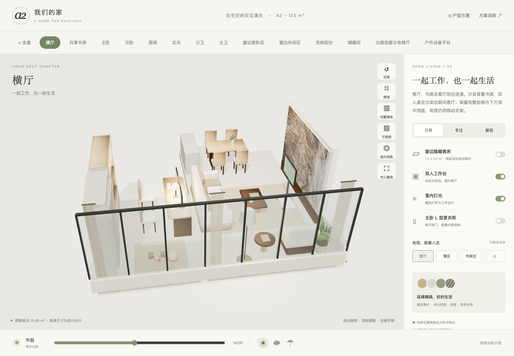

# 房屋三维交互模型

基于既有 Three.js 项目整理的独立作品集副本。保留房间几何、家具与材质、室内观察、隐藏床、电视位置、灯光时间以及二维平面图等交互。

作品集版本删除小区名称和原始实景参考照片；参考入口改为实时方案平面图。材质贴图保留，已移除图像元数据。几何沿用原有设计，用于展示建模与交互能力，不表示测绘精度。



## 运行

需要 Node.js 20.19+ 或 22.12+。

```bash
npm ci
npm run build
npm run preview
```

访问 `http://127.0.0.1:4181`。开发可用 `npm run dev`。也可构建后回到作品集根目录运行 `python3 serve.py`，从统一入口打开。

## 演示

切换房间、室内视角和俯视；展开隐藏床、切换电视位置与灯光；打开平面图观察三维状态对应关系。移动端可通过面板切换这些控制。

代码在 `src/`，材质在 `public/textures/`。不提交 `node_modules`、构建缓存、旧录屏和历史截图。

这是概念模型，不是施工图、建筑安全评估或真实日照分析。结构、改造许可、水电和尺寸均需专业人员现场核实。模型的交互状态不代表实际建筑具备对应改造条件。

[展示范围与资料说明](../../DISCLOSURE.md)
