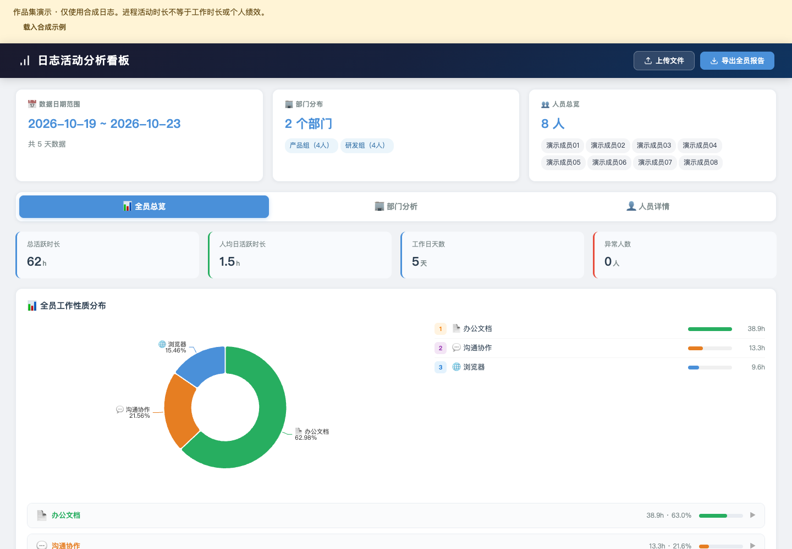

# 日志活动分析看板

从既有部门日志看板中提取的独立前端，保留全员总览、部门分析、人员详情、软件分类、文档与浏览器活动统计，以及本地文件导入/导出。

演示默认载入 8 位虚构成员、5 天、200 条合成日志。姓名、账号、窗口标题、部门和时长均为重新生成，不含真实日志、人员映射表、数据库连接或 Notebook 输出。



## 本地展示

在作品集根目录运行 `python3 serve.py`，从展示页打开本项目；也可单独运行：

```bash
python3 -m http.server 8766 --bind 127.0.0.1
```

打开 `http://127.0.0.1:8766`。页面使用本地打包的 ECharts、SheetJS 与 Tailwind，不需要 CDN。第三方许可证在 `vendor/`。

## 演示顺序

1. 查看全员的活动分布，切换部门分析。
2. 选择一位演示成员，观察不同软件及文档活动。
3. 尝试导出报告；“载入合成示例”可恢复默认数据。

文件导入只在浏览器中解析，不发送到服务端。演示时使用合成资料，勿把真实人员信息带入截图或导出的作品集文件。

## 边界

进程活动时长不等于有效工作时长或个人绩效。日均值以样本可观测日期为基础，软件分类为启发式规则，缺失记录、休假和后台进程会影响解释。本副本展示前端分析能力，不包含企业数据采集、数据库查询和原始分析 Notebook。

[展示范围与资料说明](../../DISCLOSURE.md)
