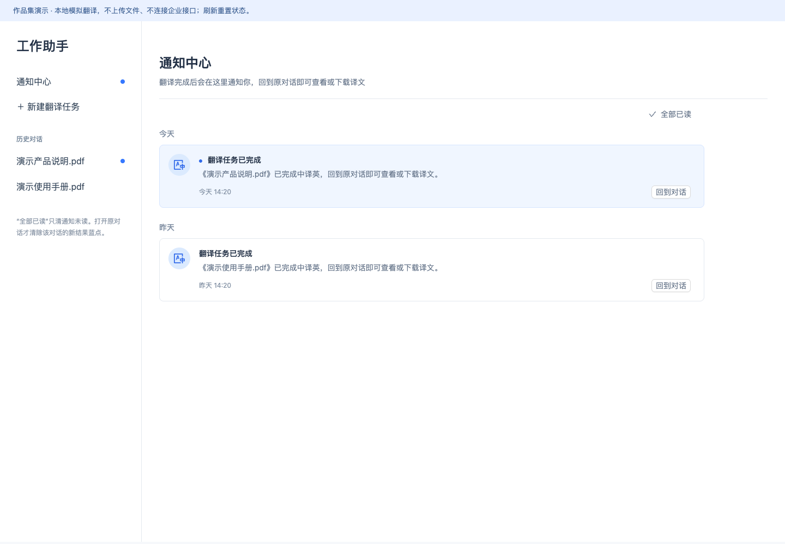

# 通知中心与后台任务反馈

从既有前台项目中提取通知列表组件、日期分组与翻译预览状态管理，补齐独立的 Vue 演示入口。保留通知卡片与已读交互；对话展示页为轻量演示适配，不包含企业应用壳、登录、真实任务接口或文件上传。



## 运行

需要 Node.js 20.19+ 或 22.12+。

```bash
npm ci
npm run build
npm run preview
```

访问 `http://127.0.0.1:4182`。也可构建后使用作品集根目录的 `python3 serve.py`。

## 产品逻辑

1. 新建翻译任务，只输入一个虚构文件名。
2. 切回通知中心，约 8 秒后任务在内存中模拟完成，出现通知与历史蓝点。
3. 点击“全部已读”，通知未读清除，历史对话的新结果蓝点保留。
4. 打开对应对话后清除该对话蓝点，可查看或下载明确标为示例的译文。

通知已读表示用户已知晓消息；历史蓝点表示有尚未查看的新结果，两者分开管理。

## 实现边界

技术栈为 Vue 3、Pinia、Vue Router、Ant Design Vue、TypeScript 与 Vite。所有状态仅保存在当前页面内存中，刷新重置。没有上传文件，没有真正翻译，没有轮询或 WebSocket 后端，也不验证真实业务权限。文件名和译文夹具为虚构资料。

主要源码：`src/views/NotificationCenter.vue`、`src/stores/translationPreview.ts`；独立入口与对话适配在 `src/App.vue` 和 `src/views/TranslationConversationPreview.vue`。
