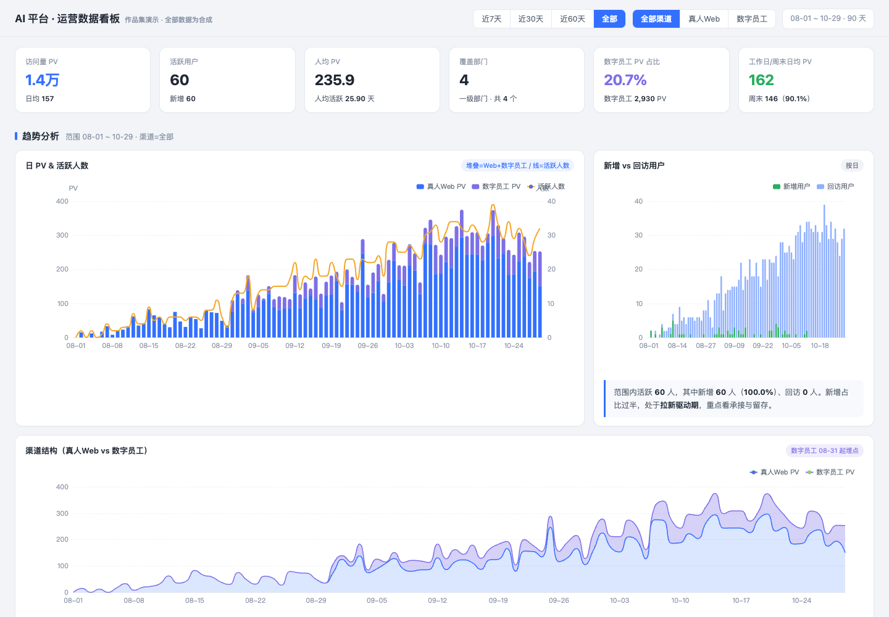

# AI 平台运营数据看板

提取既有运营看板的页面、图表与聚合逻辑，以合成数据展示平台访问量、活跃用户、渠道占比、部门覆盖、用户分层和环比。

样本由固定种子生成，覆盖 2026-08-01 至 2026-10-29 的 90 天，包含 60 位虚构用户、4 个虚构部门。原始业务数据文件没有复制进仓库。



## 本地运行

使用仓库根目录的 `python3 serve.py`，或在本目录运行：

```bash
python3 -m http.server 8767 --bind 127.0.0.1
```

访问 `http://127.0.0.1:8767`。ECharts 已本地打包，无需登录企业系统或访问 CDN。

## 演示重点

- 切换近 7/30/60 天与全部时间，观察图表和 KPI 同步重算。
- 切换 Web、数字员工与全部渠道，比较使用结构。
- 观察部门覆盖、用户分层及使用频次，讨论哪些现象需要进一步研究。

统计口径与限制见页面底部。图中的趋势来自合成样本，不代表任何公司的运营成果；自动生成的观察文字仅演示呈现方式，不能当作已证实的增长原因。未连接真实后端。

`js/app.js` 为实际筛选与聚合代码，`js/data.js` 仅为合成夹具，`vendor/` 保留 ECharts 许可证和 NOTICE。
